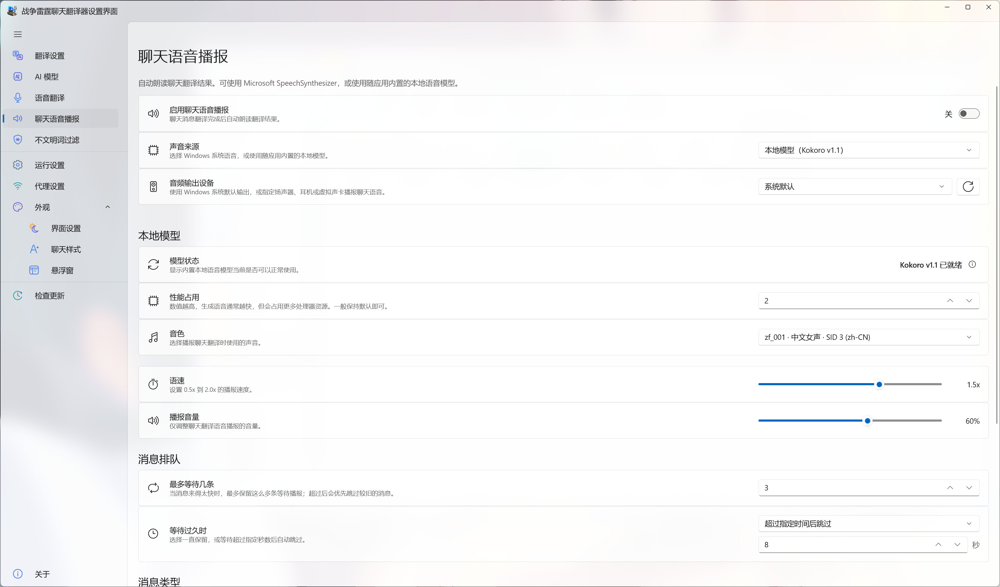

# Chat Voice Playback

[⌂ Back to English guide](en-Home) · [Previous: Voice Translation](en-Voice) · [Next: Content Filtering](en-Content-Filter)

> Read translated chat aloud so you can spend less time looking away from the game.

---

## Voice source

Choose between:

- **Microsoft SpeechSynthesizer** — uses voices installed in Windows and synthesizes locally with low overhead.
- **Local model (Kokoro v1.1)** — uses the bundled Kokoro v1.1 INT8 model through sherpa-onnx and offers multiple Chinese and English voices.
- **GPT-SoVITS character voice** — connects to a GPT-SoVITS API service you already started and lets you save a model/reference-audio profile for each character. The app does not install or start GPT-SoVITS itself.

Kokoro is bundled with the app. There is no in-app model download, import, or delete workflow. If the packaged model is missing, the Model Status card reports it and voice selection is disabled.

## Playback and audio output

Choose a voice, speaking rate, and volume, then use **Preview** to test speech before enabling it for game chat.

Under **Audio output device**, select **System default** (the Windows default output) or choose a specific speaker, headset, or virtual audio device. Use the **Refresh** button after connecting or disconnecting audio devices. If a previously saved device is marked unavailable, reconnect it or select another available device (including the Windows default).

## Kokoro model and thread count

With **Local model (Kokoro v1.1)** selected, check **Model Status** to confirm that the bundled model is present. Under **Performance usage**, adjust the Kokoro processing thread count from 1 to 16 if needed: more threads may generate speech faster but use more CPU. The default is a good starting point. If the model is missing, restore the complete application package rather than looking for an in-app download.

## GPT-SoVITS connection and character profiles

1. Start your own GPT-SoVITS API service. Enter its URL under **Service address** (default: `http://127.0.0.1:9880`) and select **Check** under **Service status** to verify that the service is reachable.
2. In **Character profiles**, choose **Add character**. Enter a **character name** and **reference audio path** (both required). Optionally specify GPT (`.ckpt`) and SoVITS (`.pth`) model weight paths to load different models; leave them blank to use the weights already loaded by the API service.
3. Set the reference text and reference language as appropriate, and choose the output-text language. Save the profile, then select **Use** on the character you want to speak with. You can also **Edit** or **Delete** saved profiles.
4. Use **Preview** to verify the selected character and settings. The service must be running when you synthesize speech, and file paths must be accessible to that GPT-SoVITS service.

The app connects to GPT-SoVITS; it does not install or launch the service for you.

## Message queue

- **Maximum queued messages** controls how many not-yet-spoken messages are retained.
- **When a message waits too long** can be set to Never Expire or a custom number of seconds.
- When the queue is full, older waiting messages are discarded first so stale battle information does not keep playing.

Friendly, enemy, and system messages can be enabled separately. [Content Filtering](en-Content-Filter) can also apply a separate TTS-only filter without changing text shown on the Dashboard or Overlay.

---

[← Previous: Voice Translation](en-Voice) · [Back to English guide](en-Home) · [Next: Content Filtering →](en-Content-Filter)
