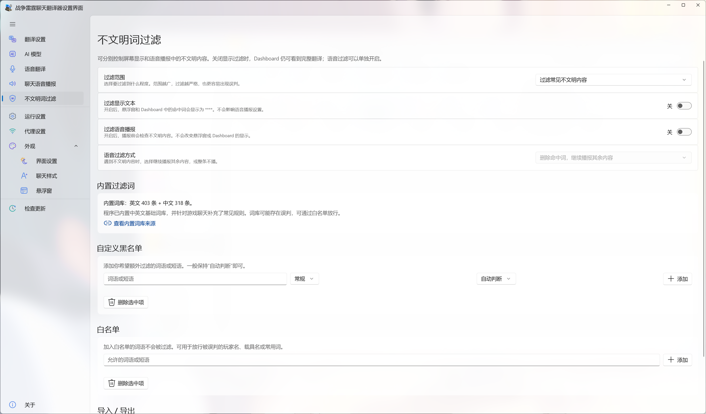

# 不文明内容过滤

[⌂ 返回简体中文目录](zh-Hans-Home) · [上一页: 聊天语音播报](zh-Hans-Chat-TTS) · [下一页: 运行与网络设置](zh-Hans-Preferences)

> 分别控制 Dashboard / 悬浮窗显示和语音播报中的不文明内容。

---

## 两个过滤开关彼此独立

- **过滤屏幕显示**：命中词在 Dashboard 和悬浮窗中显示为 `****`。
- **过滤语音播报**：只影响聊天语音播报，不改变 Dashboard 或悬浮窗中的文字。

这适合直播场景：副屏可以保留完整翻译，而进入直播音轨的 TTS 单独过滤。

## 过滤程度

全局“过滤程度”决定**最低命中严重程度**，同时适用于内置词库和自定义黑名单：

- **只过滤严重内容**：仅匹配严重程度 **3** 的词条。
- **过滤常见不文明内容**：匹配严重程度 **2 和 3** 的词条（默认选项）。
- **严格过滤（范围最广）**：同时匹配严重程度 **1、2 和 3** 的词条，覆盖面更广，但可能产生更多误判。

## 自定义黑名单与白名单

添加黑名单词条时，可分别设置**严重程度**和**匹配方式**：

- **严重程度**：1 = 宽泛、2 = 常规、3 = 严重。只有达到当前全局过滤程度的词条才会命中。
- **自动判断**：一般对英文等拉丁字母词语采用整词匹配，对汉字词语采用包含匹配。
- **完整词语**：要求匹配发生在单词边界，减少命中更长词语中的部分字符。
- **包含即可**：只要词条出现在文本中就匹配，包括更长词语内部。

如果游戏术语或玩家常用词被误判，可把它加入**白名单**；白名单优先于黑名单。自定义词条可在列表中选中并删除。内置中英文基础词库来自 LDNOOBW，来源链接可在应用“关于”页面查看。

## 导入与导出词库

- **导入 TXT**：每行填写一个黑名单词条；空行及以 `#` 开头的注释行会被忽略，其余行自动按严重程度 **2（常规）**、**自动判断**匹配方式导入，不会导入白名单。
- **导入 JSON**：可恢复此前导出的自定义黑名单（包括严重程度与匹配方式）和白名单。
- **导出 JSON**：导出**自定义**黑名单与白名单作为备份，不包含内置基础词库。

**导入会与现有词条合并，不会清空或覆盖整个词库。** 如果同一黑名单词条采用相同的实际匹配方式，会保留较高的严重程度；重复的白名单词语也不会重复添加。如需删除旧词条，请在对应列表中手动移除。

## TTS 如何处理命中内容？

可以选择删除命中的词后继续播报，或直接跳过整条聊天消息。屏幕显示和 TTS 的处理策略不会互相改变。

---

[← 上一页: 聊天语音播报](zh-Hans-Chat-TTS) · [返回简体中文目录](zh-Hans-Home) · [下一页: 运行与网络设置 →](zh-Hans-Preferences)
